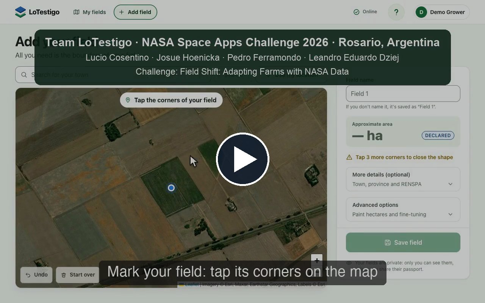

# LoTestigo

*[Leer en español](README.md)*

The field's logbook, written by satellite.

LoTestigo is a **proof of concept** built in 48 hours for the NASA Space Apps Challenge 2026 (Rosario, Argentina). It uses NASA open data, with NISAR L-band radar as the main sensor, to record what happened in a farm field: sowing, harvest, tillage, cover crop, flooding, burning or land-use change. On top of that logbook it estimates a carbon footprint and lets the grower simulate management improvements.

### [▶ Watch the 30-second demo (English subtitles)](https://lotestigo.1mj0t4h.workers.dev/landing/demo-en-subs.mp4) · [Open the app](https://lotestigo.1mj0t4h.workers.dev/)

[](https://lotestigo.1mj0t4h.workers.dev/landing/demo-en-subs.mp4)

- **App:** https://lotestigo.1mj0t4h.workers.dev/ (the example field opens without an account at [/ejemplos](https://lotestigo.1mj0t4h.workers.dev/ejemplos))
- **Demo video (28 s, English subtitles):** https://lotestigo.1mj0t4h.workers.dev/landing/demo-en-subs.mp4
- **Submission text and checklist:** [docs/SUBMISSION.md](docs/SUBMISSION.md)
- **How every number is calculated (Spanish):** [INFO.md](INFO.md)

The app interface is in English. It is built for small and mid-size soybean growers and the cooperative advisors who assist them.

## Challenges

- **Official challenge:** visualizing NISAR radar data and detecting surface change.
- **Local challenge:** AgTech for Argentina's core farming region (Zona Núcleo), with AFA (Agricultores Federados Argentinos).

## What it does

1. **Field history:** land use and crops per season since 2020.
2. **Event logbook:** a timeline with date, sensor, evidence and confidence for each event.
3. **Radar versus optical:** the evidence for each event, side by side or with a slider.
4. **Estimated carbon footprint:** kg CO2e per tonne, with every input labelled as verified, declared or estimated.
5. **Simulator:** the effect of changing a practice (adding a cover crop) on the practices score.
6. **Fertilization:** management zones from NDVI and a variable-rate nitrogen worksheet.
7. **Gross margin:** per hectare and per field.
8. **Watershed and flow:** contributing watershed, rain history and a rainfall simulator, for the test field.
9. **Territorial checks:** indicative overlap with public layers (urban proximity, native forest zoning).
10. **Field passport:** a public, printable, read-only page shared by link.

The grower does not fill in spreadsheets: they draw the field on the map and confirm or correct what was detected.

### Data origin labels

Every value shown in the app carries one of three labels, in text and color:

| Label | Meaning |
| --- | --- |
| VERIFICADO (verified) | Observed by a satellite. It does not mean validated in the field. |
| DECLARADO (declared) | Entered, corrected or confirmed by the grower. |
| ESTIMADO (estimated) | A regional, default, modelled or inferred value. |

When something is missing the app says "Sin dato" (no data) and why. Nothing is filled in or interpolated.

### Screens

| Screen | Route | What it shows |
| --- | --- | --- |
| Landing | `/` | What the project is, with a walkthrough video. |
| Examples | `/ejemplos` | The test field processed by the pipeline. No account needed, read-only. |
| My farm | `/mapa` | The account's fields on an interactive isometric model or a satellite view. |
| Draw a field | `/mapa/nuevo` | Trace the boundary on satellite imagery by tapping the corners. Works offline. |
| Field popup | from the map | Seven tabs: Satellite, Logbook, Practices, Footprint, Fertilization, Profitability, Watershed and Flow. |
| Passport | `/pasaporte/<token>` | Public read-only summary of a field. |
| Help | `/ayuda` | Illustrated guide to each screen. |

## What it is not

- It is not a certification and does not replace VISEC, RTRS or 2BSvs.
- It is not an audited footprint calculator: it is an estimate backed by satellite observations.
- Detection accuracy has not been validated. Any simulated value is flagged as such in the database and in the interface. Today no demo data is simulated.

## How it works

```
[Offline satellite processing]  -->  event JSON files + PNG evidence images
                                              |
                                   import_events command
                                              v
[Angular] <-- REST/JSON --> [Django + DRF] <--> [PostgreSQL]
```

The backend never processes satellite imagery during a request. Radar and optical analysis runs separately (the `pipeline/` folder) and its output is loaded with a management command.

In addition, the browser queries open NASA services that need no login to show data for any polygon: NASA POWER (weather), ORNL DAAC (MODIS NDVI and land cover), the Earthdata CMR catalog (NISAR and HLS passes) and GIBS (imagery). That data is shown with its source and is cached on the device, not stored in the database.

### Detection method (proof of concept, not validated)

1. **Field backscatter:** mean gamma0 over the valid pixels of the polygon, in dB.
2. **Anomaly:** field minus the median of the surrounding landscape on the same date. This separates what happened in the field from what happened to the whole area.
3. **Excluded dates:** dates where the landscape as a whole departs from its median over time by more than 5 median absolute deviations. October 7, 2026 is excluded: every field rose 3 to 6 dB at once and NASA POWER reports 46 mm of rain.
4. **Threshold:** a change in HH anomaly between consecutive passes is an event if it exceeds 3 standard deviations of the changes seen in reference fields and persists on the next pass. The threshold is currently 1.03 dB.
5. **Event type:** HLS NDVI is used to interpret the change.

Result so far: one event. In the test field (87 ha, Casilda, Santa Fe), HH dropped 1.78 dB against the landscape between September 1 and 13, 2026 and stayed down, while HV rose. It is logged as sowing on September 7, 2026, plus or minus 6 days. A prior tillage pass cannot be ruled out. Details in [pipeline/README.md](pipeline/README.md) (Spanish).

## Data sources

| Source | Use |
| --- | --- |
| NISAR (NASA/ISRO), L-band, L2 GCOV | Surface change detection and radar evidence images |
| HLS v2.0 (NASA) | NDVI to interpret radar changes, optical evidence images |
| MODIS MOD13Q1 and MCD12Q1 (NASA) | NDVI every 16 days and yearly land cover, queried live per polygon |
| NASA POWER | Rainfall and soil wetness, queried live |
| Earthdata CMR and GIBS (NASA) | Catalog of passes over the field; imagery tiles |
| GPM IMERG, SMAP, MODIS MOD16 (NASA) | Rainfall events, soil moisture and evapotranspiration for the watershed module |
| Copernicus DEM GLO-30 (ESA) | Terrain for the watershed module. Not NASA data |
| Sentinel-2 L2A (ESA) | Backdrop used to draw the example fields. Not NASA data |
| Esri World Imagery, OpenStreetMap | Basemaps and place search |

The full list, with emission-factor and method references, is in [docs/SUBMISSION.md](docs/SUBMISSION.md).

This project uses NASA open data. It is not affiliated with or endorsed by NASA.

## Stack

- **Backend:** Python 3.13, Django 6.1, Django REST Framework
- **Database:** PostgreSQL 17 (Docker Compose)
- **Frontend:** Angular 22, TypeScript, Leaflet
- **Pipeline:** Python (asf_search, h5py, rasterio, pystac-client)
- **Hosting:** Cloudflare Workers (frontend) and Railway (backend and database)

Field polygons are stored as GeoJSON in a JSON field, without PostGIS.

## Run it locally

Requirements: Python 3.13, Node 24 LTS and Docker.

```bash
# Environment variables (set POSTGRES_PASSWORD)
cp .env.example .env

# Database
docker compose up -d db

# Backend
cd backend
python -m venv .venv && source .venv/bin/activate
pip install -r requirements.txt
python manage.py migrate
python manage.py import_events ../data/demo/*.json
python manage.py runserver

# Tests
pytest

# Frontend (http://localhost:4200, proxies /api to the backend)
cd frontend
npm install
npx ng serve
```

`http://localhost:8000/api/health/` should answer `{"status": "ok"}`.

Credentials (Earthdata, database) live only in a `.env` file that is not committed. See `.env.example`.

## Repository layout

```
backend/     Django apps: core, accounts, lots, events, carbon, passports, hydrology, territory, market
frontend/    Angular features: landing, auth, map, examples, lot, footprint, fertilization, profit, water, passport, help
pipeline/    Remote-sensing scripts (offline)
data/        Demo field, evidence images, hydrology grids, public layers
docs/        Team split and submission text
worker/      Cloudflare Worker that serves the app and forwards /api to the backend
```

## Known limitations

- Detection is a proof of concept. The threshold and the reference fields are a proposal by the team and have not been validated in the field.
- A single event has been detected. No script detects harvest, tillage, cover crops, flooding, burning or land-use change yet.
- Nine of the ten NISAR scenes used are provisional products.
- Growers' own fields do not receive detected events yet: the pipeline runs by hand for the example fields.
- Emission factors are US averages and IPCC defaults. Soil carbon is not modelled, so cover crops do not lower the footprint.
- Watershed and flow results are unvalidated simulations: there are no measured flows in the basin.
- MODIS pixels are 5 to 21 ha; NASA POWER describes an area of about 50 km.

## Use of SI tools

In line with the NASA Space Apps Challenge 2026 rules on Super Intelligence (SI) tools:

- **Code and documentation:** parts of the source code, tests and documentation in this repository were written with the assistance of Claude Code (Anthropic), a large-language-model coding assistant, and reviewed by the team. The project instructions given to the assistant are in [CLAUDE.md](CLAUDE.md).
- **Data:** no satellite data, detected events, evidence images, emission factors or metrics were generated by SI. They come from the sources listed above.
- **Logo:** a flat geometric mark (three stacked layers) drawn by the script [assets/draw-logo.py](assets/draw-logo.py), written with SI assistance. It uses no NASA branding or design elements.
- **Idea and method:** the project idea, the choice of data sources and the detection method were defined by the team.

## License

[MIT](LICENSE)
