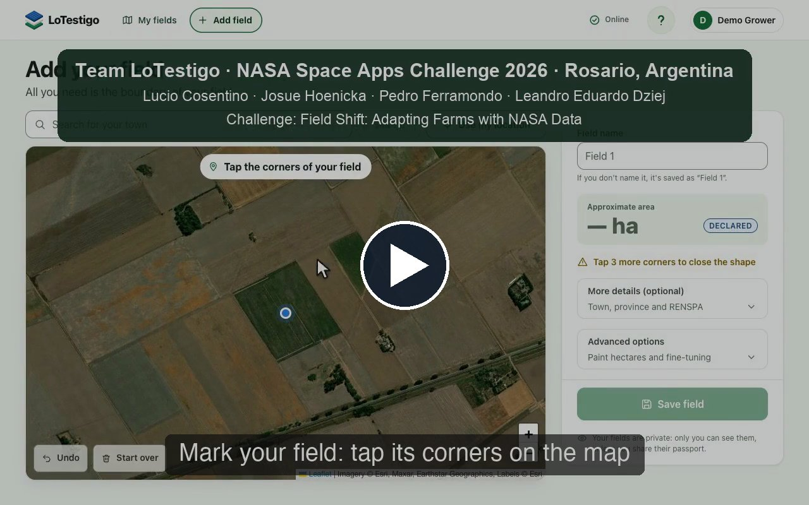
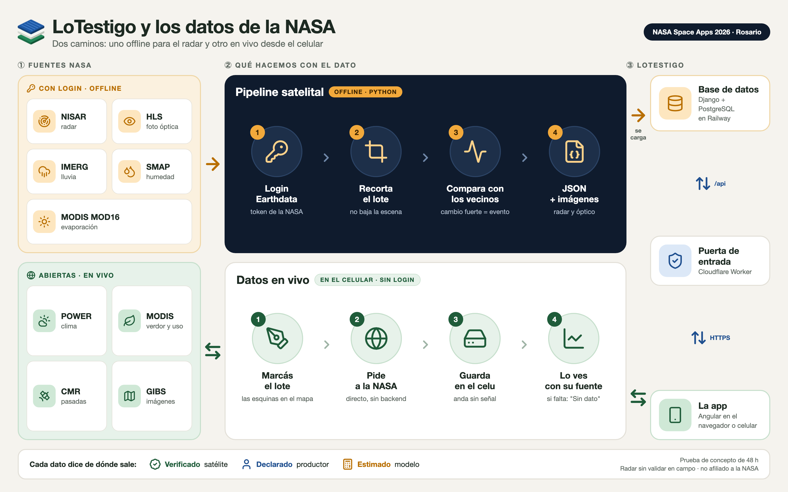

# LoTestigo

*[Read in English](README.en.md) · [Submission text and checklist](docs/SUBMISSION.md)*

Bitácora de manejo de un lote agrícola, detectada por satélite.

LoTestigo es una **prueba de concepto** desarrollada en 48 horas para el NASA Space Apps Challenge 2026 (sede Rosario). Usa datos abiertos de la NASA, con radar NISAR (banda L) como sensor principal, para registrar qué pasó en un lote: siembra, cosecha, remoción de suelo, cobertura, anegamiento, quema o cambio de uso. Sobre esa bitácora estima una huella de carbono y permite simular mejoras de manejo.

### [▶ Ver la demo de 30 s (subtítulos en inglés)](https://lotestigo.1mj0t4h.workers.dev/landing/demo-en-subs.mp4) · [Abrir la app](https://lotestigo.1mj0t4h.workers.dev/)

[](https://lotestigo.1mj0t4h.workers.dev/landing/demo-en-subs.mp4)

- **App:** https://lotestigo.1mj0t4h.workers.dev/ (el lote de ejemplo se ve sin cuenta en [/ejemplos](https://lotestigo.1mj0t4h.workers.dev/ejemplos))
- **Video de la demo (28 s, subtítulos en inglés):** https://lotestigo.1mj0t4h.workers.dev/landing/demo-en-subs.mp4

La interfaz de la app está en inglés.

## Desafíos

- **Desafío oficial:** visualización de datos de radar NISAR y detección de cambios en la superficie.
- **Desafío local:** AgTech para la Zona Núcleo, junto a AFA (Agricultores Federados Argentinos).

## Qué hace

1. **Historial del lote:** uso del suelo y cultivos por campaña desde 2020.
2. **Bitácora de eventos:** línea de tiempo con fecha, sensor, evidencia y nivel de confianza por evento.
3. **Comparación radar contra óptico:** la evidencia de cada evento, lado a lado.
4. **Huella de carbono estimada:** kg CO2e por tonelada, con cada dato etiquetado como verificado, declarado o estimado.
5. **Simulador:** efecto de cambiar una práctica (por ejemplo, sumar cultivo de cobertura) sobre la huella y el puntaje.
6. **Pasaporte del lote:** vista compartible por enlace público, imprimible.

El productor no carga planillas: marca su lote en el mapa y confirma o corrige lo que se detectó.

### Cómo se usa

1. **Inicio:** la página de inicio presenta el proyecto e invita a crear una cuenta gratis (mail y contraseña) o a ingresar. Los lotes de cada productor son privados: solo los ve y los edita quien los marcó. Los lotes de ejemplo de la NASA se ven sin cuenta en `/ejemplos`.
2. **Mi campo:** los lotes de la cuenta en una maqueta isométrica interactiva (motor propio en canvas, sin dependencias). Cada bloque ilustra el último evento registrado y se puede pintar con el NDVI actual de MODIS. También hay vista satelital. Sin lotes, ofrece usar la ubicación del dispositivo para encontrar el campo; si no se comparte, se busca en el mapa satelital.
3. **Marcar un lote:** se traza el perímetro sobre la imagen satelital tocando las esquinas. En opciones avanzadas se pueden pintar hectáreas (grilla de 1 ha o 1/4 ha que se puede girar para alinearla con los alambrados) o ajustar los vértices. Sin conexión, el lote queda en el dispositivo y se sube solo cuando vuelve la red.
4. **Ficha del lote:** la bitácora con su evidencia y, consultados en vivo para el polígono, el NDVI de MODIS, la lluvia y la humedad de NASA POWER, las pasadas de NISAR y HLS y la cobertura del suelo por año.
5. **Huella, fertilización y rentabilidad:** la huella con el origen de cada dato, los ambientes del lote por NDVI con una planilla de dosis variable de nitrógeno, y el margen bruto con el área y el rinde del lote y el precio y los costos que declara el productor.

La app funciona sin conexión: un service worker guarda la interfaz y cada respuesta del backend y de la NASA queda guardada en el dispositivo.

## Qué no es

- No es una certificación y no reemplaza a VISEC, RTRS ni 2BSvs.
- No es una calculadora de huella auditada: es una estimación con respaldo satelital.
- La precisión de detección no está validada. Todo dato simulado se marca como tal en la base y en la interfaz.

## Cómo funciona



```
[Procesamiento satelital offline]  -->  JSON de eventos + imágenes PNG
                                              |
                                   comando import_events
                                              v
[Angular] <-- REST/JSON --> [Django + DRF] <--> [PostgreSQL]
```

El backend no procesa imágenes satelitales. El análisis de radar y óptico se hace aparte (carpeta `pipeline/`) y su salida se importa con un comando de gestión.

El navegador consulta además servicios abiertos de la NASA que no piden login, para mostrar los datos de cualquier polígono: NASA POWER (clima), ORNL DAAC (NDVI y cobertura de MODIS), el catálogo CMR de Earthdata (pasadas de NISAR y HLS) y GIBS (imágenes por fecha). Esos datos se muestran con su fuente y no se guardan en la base.

Cómo se usa cada pantalla, de dónde sale cada dato (NISAR, HLS, MODIS y NASA POWER) y cómo se calcula cada número (bitácora, huella, puntaje, fertilización y rentabilidad) está en [INFO.md](INFO.md).

## Stack

- **Backend:** Python 3.13, Django 6.1, Django REST Framework
- **Base de datos:** PostgreSQL 17 (Docker Compose)
- **Frontend:** Angular 22, TypeScript
- **Mapa:** Leaflet

Los polígonos se guardan como GeoJSON en un campo JSON, sin PostGIS.

## Cómo correrlo

Requisitos: Python 3.13, Node 24 LTS (ver `frontend/.nvmrc`) y Docker.

```bash
# Variables de entorno (completar POSTGRES_PASSWORD)
cp .env.example .env

# Base de datos
docker compose up -d db

# Backend
cd backend
python -m venv .venv && source .venv/bin/activate
pip install -r requirements.txt
python manage.py migrate
python manage.py import_events ../data/demo/*.json
python manage.py runserver

# Pruebas
pytest

# Frontend (en http://localhost:4200, con proxy de /api al backend)
cd frontend
npm install
npx ng serve
```

Para comprobar que todo está conectado: `http://localhost:8000/api/health/` responde `{"status": "ok"}` y el encabezado del frontend dice "Conectado".

Las credenciales (Earthdata, base de datos) van solo en un archivo `.env`, que no se sube al repositorio. Hay un `.env.example` de referencia.

## Despliegue

La demo está publicada en **https://lotestigo.1mj0t4h.workers.dev** y no aparece en buscadores. La página de inicio y los lotes de ejemplo se ven sin cuenta; para marcar lotes propios hay que crear una.

Corre en Cloudflare Workers (`wrangler.jsonc` y `worker/index.js`):

- El Worker publica el build de Angular. Las rutas de la app (`/mapa`, `/lotes/1`, `/pasaporte/<token>`) devuelven `index.html` y las resuelve el router de Angular.
- `/api/` y `/media/` van al backend de Django, igual que el proxy de `ng serve`. Los archivos de `/media/` que genera el build los sirve el propio Worker: los íconos de Leaflet y las imágenes de `data/evidence/`, que el build copia a `/media/evidence/`.
- Django y PostgreSQL corren en Railway (proyecto `lotestigo`, servicios `backend` y `Postgres`). El Worker le pasa los pedidos a la dirección pública del backend, `API_ORIGIN` en `wrangler.jsonc`. Si el backend no responde, `/api/` devuelve 502 y el encabezado muestra "Sin conexión con el servidor".

El backend se construye con `backend/Dockerfile` (la variable `RAILWAY_DOCKERFILE_PATH` del servicio apunta a ese archivo). Cada vez que arranca aplica las migraciones e importa los lotes nuevos de `data/demo/`; los que ya están cargados se saltean, así no se pierden las correcciones ni los pasaportes. Para publicar cambios del backend, con acceso al proyecto de Railway:

```bash
npm run deploy:backend
```

Si cambia el JSON de un lote que ya está cargado, hay que reimportarlo a mano. `--replace` borra también sus correcciones y pasaportes:

```bash
npx --yes @railway/cli@5.71.0 ssh --service backend python manage.py import_events ../data/demo/<archivo>.json --replace
```

Variables del servicio `backend` en Railway: `POSTGRES_*` (tomadas del servicio `Postgres`), `DJANGO_SECRET_KEY`, `DJANGO_DEBUG=0`, `DJANGO_ALLOWED_HOSTS` con el dominio de Railway, `PORT=8000` y `RAILWAY_DOCKERFILE_PATH=backend/Dockerfile`.

Para publicar el frontend a mano, con Node 24 (ver `frontend/.nvmrc`) y una sesión de Wrangler en la cuenta de Cloudflare de la demo:

```bash
npm run deploy
```

Compila el frontend (`npm ci` y `ng build`) y lo sube con Wrangler.

### Publicación automática

Cada push a `main` corre `.github/workflows/deploy.yml`, que publica solo:

1. **Backend:** si el push cambió algo en `backend/` o `data/`, lo sube a Railway con `railway up`. Al correr el workflow a mano (Actions → Deploy → Run workflow) se puede elegir publicarlo igual.
2. **Frontend:** después del backend, compila Angular y lo publica en Cloudflare Workers. Si el backend falló, el frontend no se publica.

Necesita dos secrets en el repositorio (Settings → Secrets and variables → Actions). Sin ellos, el workflow solo compila. El id de la cuenta de Cloudflare no es secreto y está en `wrangler.jsonc` (`account_id`):

| Secret | Qué es | Dónde se crea |
|---|---|---|
| `CLOUDFLARE_API_TOKEN` | Token de API con la plantilla "Edit Cloudflare Workers" | Cloudflare → My Profile → API Tokens |
| `RAILWAY_TOKEN` | Token del proyecto `lotestigo`, entorno `production` | Railway → proyecto → Settings → Tokens |

Con la CLI de GitHub (cada comando pide el valor y no lo muestra):

```bash
gh secret set CLOUDFLARE_API_TOKEN -R Luciocos/NASA
gh secret set RAILWAY_TOKEN -R Luciocos/NASA
```

Después de cargarlos, para publicar lo que ya está en `main` sin esperar al próximo push:

```bash
gh workflow run deploy.yml -R Luciocos/NASA
```

## Estructura

Monorepo separado por funcionalidad:

```
backend/     Django: core, accounts, lots, events, carbon, passports
frontend/    Angular: features landing, auth, map, examples, lot, footprint, fertilization, profit, passport
pipeline/    Notebooks y scripts de teledetección (offline)
data/        Lotes de demostración e imágenes de evidencia
docs/        Reparto del trabajo en el equipo
```

Quién es dueño de cada parte está en [docs/EQUIPO.md](docs/EQUIPO.md). Las reglas de trabajo, el modelo de datos, la API y el contrato de importación están en [CLAUDE.md](CLAUDE.md).

## Fuentes de datos

| Fuente | Uso |
|---|---|
| NISAR (NASA/ISRO), banda L | Labranza, anegamiento, cambios de superficie |
| HLS y Landsat (NASA/USGS) | Uso del suelo desde 2020, cobertura |
| MODIS y VIIRS (NASA) | Focos de calor, quema de rastrojos |
| MODIS (NASA), MOD13Q1 y MCD12Q1 | NDVI cada 16 días y cobertura del suelo anual, consultados en vivo por polígono |
| SMAP y NASA POWER | Humedad de suelo y clima |
| Sentinel-1 (ESA), banda C | Respaldo cuando no hay escenas NISAR; no es dato NASA |

Este proyecto usa datos abiertos de la NASA. No está afiliado a la NASA ni cuenta con su aval.

## Uso de herramientas de SI

Según las reglas del NASA Space Apps Challenge 2026 sobre herramientas de Super Intelligence (SI):

- **Código y documentación:** parte del código, de las pruebas y de la documentación de este repositorio se escribió con la asistencia de Claude Code (Anthropic), un asistente de programación basado en un modelo de lenguaje, y fue revisada por el equipo. Las instrucciones que se le dieron están en [CLAUDE.md](CLAUDE.md).
- **Datos:** ningún dato satelital, evento, imagen de evidencia, factor de emisión ni métrica fue generado con SI. Salen de las fuentes citadas arriba.
- **Logo:** es un dibujo geométrico plano (tres capas apiladas) que genera el script [assets/draw-logo.py](assets/draw-logo.py), escrito con asistencia de SI. No usa elementos de la marca de la NASA.
- **Idea y método:** la idea del proyecto, la elección de las fuentes y el método de detección los definió el equipo.

## Licencia

[MIT](LICENSE)
